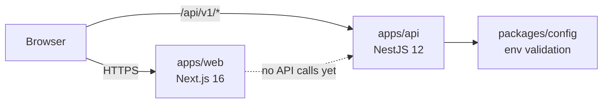
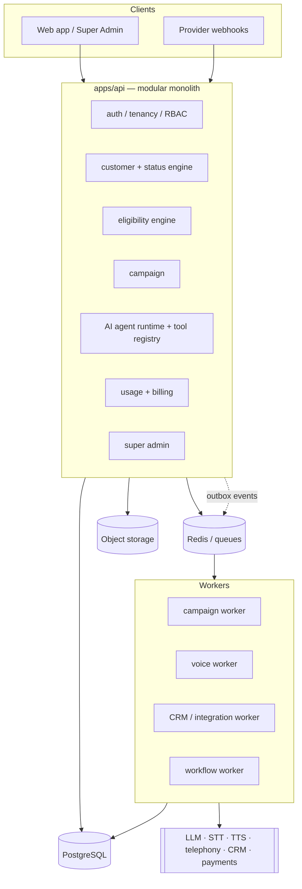
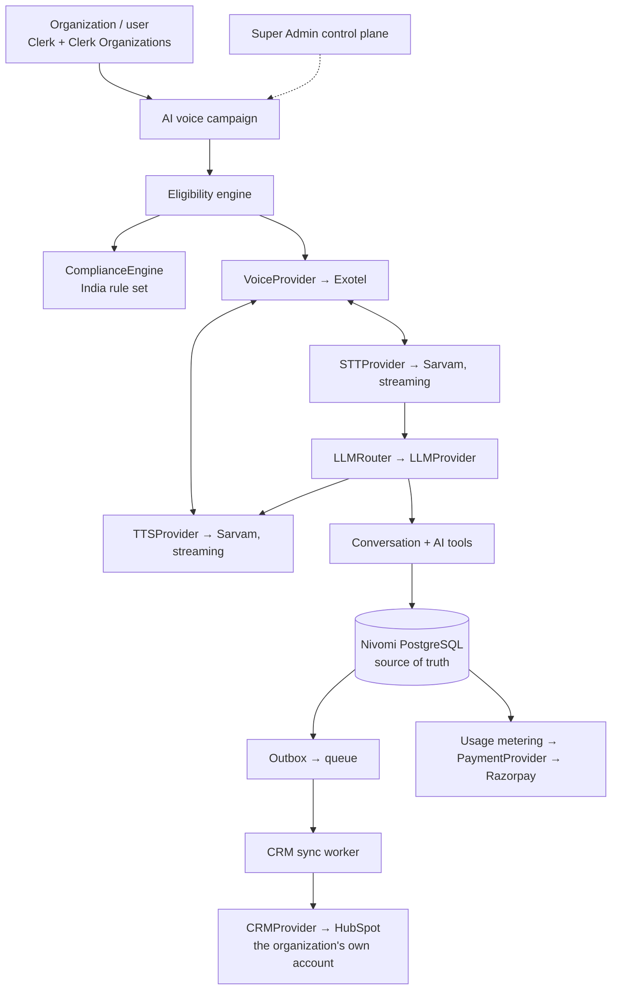

# Architecture

## 1. Implemented today (foundation)

| Component         | Responsibility                                                                                                                                               |
| ----------------- | ------------------------------------------------------------------------------------------------------------------------------------------------------------ |
| `packages/config` | Loads dev-only env files, validates env with zod, fails fast without echoing values                                                                          |
| `apps/api`        | HTTP API. Request pipeline: pino-http (request ID, structured log) → helmet → CORS allowlist → JSON body (1 MB) → versioned router → global exception filter |
| `apps/web`        | Public website (App Router, static): homepage, Coming Soon product pages, legal placeholders; brand tokens in Tailwind; no API calls yet                     |

API request lifecycle:

1. `resolveRequestId` accepts a well-formed inbound `x-request-id` or generates a UUID, echoes it
   on the response and binds it to every log line for the request.
2. helmet sets hardening headers; CORS allows only `CORS_ALLOWED_ORIGINS`.
3. Routes live under `/api/v{n}/` (URI versioning, default v1).
4. `AllExceptionsFilter` turns every error into the envelope in [API.md](API.md). 5xx details are
   logged, never returned.

Configuration is validated once at startup (`loadApiEnv`) and provided through DI as `API_ENV`.

## 2. Target architecture

**Style:** modular monolith + background workers + provider adapters (ADR-001). One deployable
API whose domains are isolated Nest modules with explicit public services; workers share the same
packages and consume queues. Any module can later be extracted into a service without rewriting
callers, because modules communicate through interfaces and events, not shared tables.

Initial providers and hosting (ADR-009 to ADR-014):

Everything runs in AWS ap-south-1 on ECS Fargate with RDS PostgreSQL, ElastiCache Redis and S3.
The voice runtime is a separate stateful worker service because calls are long-lived streaming
sessions.

Key rules (full list in [CLAUDE.md](../CLAUDE.md)):

- **Tenancy:** every tenant-owned row has `organization_id`; tenant context comes from the
  authenticated membership only. PostgreSQL row-level security is under evaluation as defense in
  depth (ADR-008).
- **Events:** state changes write an outbox row in the same transaction; a relay publishes to
  queues; consumers are idempotent (at-least-once delivery).
- **Providers:** domain code depends on `LLMProvider`, `VoiceProvider`, `STTProvider`,
  `TTSProvider`, `CRMProvider`, `PaymentProvider`, `StorageProvider`; vendor code lives in adapters.
- **Async by default** for campaigns, imports, exports, CRM sync and AI post-processing.

## 3. Gap between current and target

Everything in section 2 other than the HTTP foundation is **not built**. The order is set by
[ROADMAP.md](ROADMAP.md) and the BMAD PRD/architecture outputs. The data-access layer (ADR-008)
must be decided before the first persistent feature.
